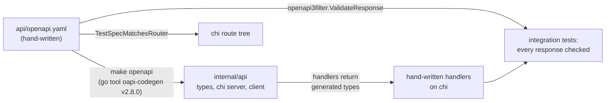

# OpenAPI Contract Checks Implementation Plan

**Date:** 2026-10-24
**Status:** Implemented on `feat/openapi-contract-checks`
**Builds on:** [2026-06-12 contract-first codegen](2026-06-12-oapi-codegen-contract-first.md)
**Ported from:** asclepius-backend ADR 0022, "Generate wire types from the
contract and check responses against it", and its supporting research note.

**Goal:** Make drift between `api/openapi.yaml` and what the handlers actually
send fail the build or a test, and put the generator on a pinned, current,
reproducible toolchain.

---

## Where the template stands

The 2026-06-12 work made `api/openapi.yaml` the source of truth and generates
`internal/api/{types,server,client}.gen.go`. That gave us:

- **Operations:** constructing `api.ServerInterfaceWrapper` requires every
  operation to be implemented, so a new spec operation with no handler fails to
  compile.
- **Requests:** `OapiRequestValidator` validates every `/api/v1` request against
  the spec before a handler runs.

It left four gaps.

1. **Responses are unchecked.** Handlers write hand-written structs
   (`todo.TodoResponse`, `auth.AuthResponse`, `auth.UserResponse`,
   `auth.ApprovedUserResponse`) that duplicate the generated ones. A field the
   spec adds, renames, or removes changes the generated types and the client
   consumers build from the spec, and nothing in this repository notices.
2. **Routes are mounted by hand.** Every operation is wired with
   `r.Get(path, wrapper.Op)` to keep the per-group middleware. A typo in a path
   or a forgotten route compiles, because the wrapper method exists either way.
   The existing `internal/router/contract_test.go` only checks that the spec
   has paths and that a client can be built.
3. **The generator is unpinned and old.** `make install-tools` runs
   `go install ...@v2.4.1`, so the binary a contributor has is whatever they
   installed last. v2.4.1 predates four code-injection advisories (a crafted
   spec emits arbitrary Go into the generated file): GHSA-rjwr-m7qx-3fjr,
   GHSA-jwgf-6xff-4hvp, GHSA-xrqw-w576-xgj2, GHSA-9c2f-gr95-7wqw. The latest
   release is v2.8.0. The stale check is copied into four CI blocks, each
   installing its own copy.
4. **kin-openapi is behind a crash fix, in production.** The request validator
   runs on every API request with kin-openapi v0.140.0. GHSA-g3f9-hcw7-r9w2
   (fixed in v0.150.0) lets concurrent request validation abort the process
   with `concurrent map writes` when a schema has an object-valued `default`
   with inner defaults. Today's spec has no `default`, so it is not triggered,
   but the template exists to be forked and extended, and the first service that
   adds such a default would inherit a process crash.

## What we are not changing

These were evaluated in asclepius-backend and rejected; the reasons carry over.

- **No strict server.** Strict handlers get no `http.ResponseWriter` or
  `*http.Request`, can emit only one `Set-Cookie`, and decode bodies with a bare
  `json.Decoder` (no size cap, no unknown-field rejection). The template's
  handlers rely on `http2.DecodeJSON` for both.
- **No ogen.** It owns routing, which would take the operations out of chi and
  lose per-group middleware.
- **No runtime response validation.** Response validation runs in the
  integration suite only. Buffering and validating every production response
  costs latency for a check that tests can make.
- **The request validator stays.** Unlike asclepius-backend, the template has
  always validated requests in production and its error handler already writes
  the standard `{"detail": ...}` body.

## Design

Four checks hold the contract to the code:

| Check       | Catches                                                   | Where                                         |
| ----------- | --------------------------------------------------------- | --------------------------------------------- |
| Operations  | spec operation with no handler                            | compile (`ServerInterface`)                   |
| Routes      | route in chi but not in spec, or the reverse              | `internal/router/routes_test.go`              |
| Types       | handler response no longer matches the schema's fields    | compile (handlers return `api.*` types)       |
| Responses   | wrong status, missing required field, wrong type or null  | `internal/integration/contract_test.go`       |

Plus one hygiene check: `make verify-openapi` fails when the committed
`internal/api` output is stale against the spec.

## Tasks

### Task 1: Pin the generator as a `go tool`

- [x] `go get -tool github.com/oapi-codegen/oapi-codegen/v2/cmd/oapi-codegen@v2.8.0`.
      The version is recorded in `go.mod` and `go.sum`, so every contributor
      and CI job runs the same binary with no install step.
- [x] `Makefile`: `openapi` runs `go tool oapi-codegen`; drop the
      `go install` line from `install-tools`.
- [x] `internal/api/gen.go`: `//go:generate go tool oapi-codegen ...`.
- [x] Add `make verify-openapi`: regenerate each config into a temp directory
      and diff against `internal/api`. Diffing in a temp directory, rather than
      `git diff` after regenerating in place, means correct but uncommitted
      output passes locally and the check never rewrites the working tree.
      Add it to `make verify`.
- [x] CI (`ci.yml`, `reusable-build.yml`): replace the four copied
      install-and-diff blocks with `make verify-openapi`.

### Task 2: Bump the runtime dependencies

- [x] kin-openapi v0.140.0 → v0.152.0 (past GHSA-g3f9-hcw7-r9w2).
- [x] oapi-codegen/runtime and nethttp-middleware to the versions v2.8.0's
      generated code requires.
- [x] `make openapi`, then `go build ./...` and `go test -short ./...`.
- [x] v2.8.0 deprecates `api.GetSwagger()` in favour of `api.GetSpec()`
      (staticcheck SA1019); rename the three call sites.
- [x] v2.8.0 no longer puts `BearerAuthScopes` into the request context.
      Nothing in the template reads it; authentication stays in chi middleware.

### Task 3: Make the spec describe what handlers send

oapi-codegen v2.5+ adds `omitempty` to an optional nullable field. A field the
handler always sends, possibly as `null`, must therefore be `required` **and**
`nullable`, or the regenerated type silently drops the `null` from the wire.

- [x] `TodoResponse.description` and `TodoResponse.due_date`: add to `required`.
      The handler always writes both keys today; the spec now says so.
- [x] Regenerate and confirm the generated `TodoResponse` fields have no
      `omitempty`.

### Task 4: Handlers return generated types

Map at the handler edge. Domain types stay in `internal/domain`; generated names
(`Id`, `UserId`) stop at the mapping function.

- [x] `internal/todo/handler.go`: delete `TodoResponse`; `toTodoResponse`
      returns `api.TodoResponse`.
- [x] `internal/auth/handler.go`: delete `AuthResponse`, `UserResponse`,
      `ApprovedUserResponse`; build `api.AuthResponse`, `api.UserResponse`,
      `api.ApprovedUserResponse`.
- [x] A schema change the handler has not followed now stops compiling.

### Task 5: Route coverage test

- [x] Replace `internal/router/contract_test.go` with `routes_test.go`:
      `TestSpecMatchesRouter` builds the router, walks the chi tree with
      `chi.Walk`, and compares the `/api/v1` method and path pairs against the
      spec's operations, failing in either direction.

### Task 6: Response validation in the integration suite

- [x] `internal/integration/contract_test.go`: `withResponseContract(t, h)`
      wraps the router, tees each response, and validates it with
      `openapi3filter.ValidateResponse`, `IncludeResponseStatus: true` so an
      undocumented status code fails, and `NoopAuthenticationFunc` so
      authentication stays in chi.
- [x] Requests are not validated here; the production validator already does
      that, and tests send malformed requests on purpose.
- [x] A request to a route the spec does not describe fails the test, except
      the operational routes outside `/api/v1` (`/`, `/health`).
- [x] `newTestRouter` takes `t` and wraps the router, so every existing
      integration test is now also a contract test.
- [x] First run found real drift: `RequireAdmin` answers `403` on all four
      `/admin/approved-users*` operations, and the spec did not document it.
      Consumers' generated clients had no type for that response. Added `403`
      to each.

### Task 7: Documentation

- [x] `docs/api.md`: the workflow and the four checks, the
      `required` + `nullable` rule, and the map-at-the-edge rule.
- [x] This plan.

## Known risks and follow-ups

- **Case-insensitive double decode.** The request validator decodes the body
  with kin-openapi, then the handler decodes it again with `encoding/json`,
  which matches keys case-insensitively. A body such as
  `{"title":"ok","TITLE":""}` can validate as one value and bind as another.
  Handler-side checks (`validator.*`, service `ErrInvalidTodoParams`) still run
  on the bound value, so this is defence in depth, not a bypass. The upstream
  fix (oapi-codegen #2612, needs kin-openapi ≥ v0.151.0 and runtime ≥ v1.8.0)
  is merged but unreleased; adopt it when it ships.
- **Only router traffic is checked.** A test that calls a handler directly
  bypasses response validation. Route new tests through `newTestRouter`.
- **Extra response fields pass.** No response schema sets
  `additionalProperties: false`, so a handler that sends an undocumented field
  passes the response check. The generated-types change makes that hard to do
  by accident.
- **Keep the generator current.** Renovate should track the `tool` directive in
  `go.mod`; review the generated diff on every bump.

## Revisit when

- oapi-codegen's strict server exposes `http.ResponseWriter` and
  `*http.Request` (#1427) and supports several `Set-Cookie` headers.
- The spec moves to OpenAPI 3.1 and v2.8's initial 3.1 support is not enough.
